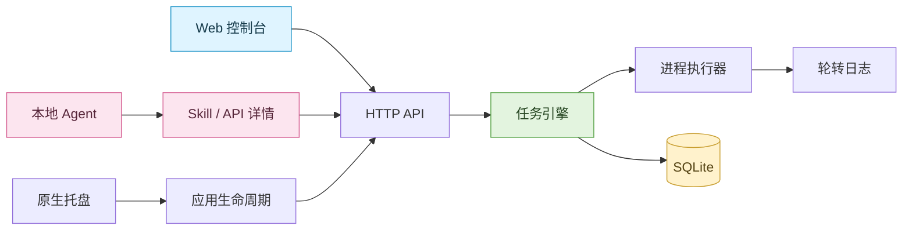

<div align="center">


# Rooster

**本地任务守护与调度，让进程、定时任务和 Agent 操作集中在一处。**


[快速开始](#快速开始) · [功能一览](#功能一览) · [Agent 接入](#agent-接入) · [开发与构建](#开发与构建) · [架构](#架构)

</div>

---

Rooster 将原生托盘应用、本地 Web 控制台、SQLite 执行记录和进程管理结合起来。
既可以在页面管理开发服务与定时命令，也可以让本地 Agent 读取 Skill 和 API 详情，直接调用 HTTP 接口。

## 功能一览

| 场景 | 能力 |
| --- | --- |
| 常驻服务 | 失败重启、始终重启或不重启；连续失败上限与指数退避 |
| 定时命令 | 五字段 Cron；跳过重叠执行或允许并行；预览未来五次触发时间 |
| 命令执行 | Shell 管道与重定向，或直接执行程序并传入参数 |
| 执行环境 | 工作目录、自定义 Shell、登录环境缓存与任务环境变量覆盖 |
| 状态与日志 | 当前状态、执行历史、退出码与轮转日志 |
| 配置查看 | 编辑入口始终可打开；启用或运行中的任务以只读表单展示配置 |
| Agent 操作 | 内置 Skill 与完整 API 文档；页面可复制链接、全文和接入信息 |
| 数据与退出 | SQLite 持久化、迁移、中断恢复；macOS / Linux / Windows 进程树终止实现 |

### 两类任务怎么选？

| | 常驻任务 `resident` | 定时任务 `scheduled` |
| --- | --- | --- |
| 适用场景 | 开发服务、后台工作进程 | 定期备份、同步、检查脚本 |
| 启用后 | 启动守护进程 | 注册 Cron 调度 |
| 停用后 | 停止守护，请求终止其管理的执行 | 停止未来触发，已有执行继续运行 |
| 手动运行一次 | 支持 | 支持 |
| 自动策略 | 重启策略与连续失败上限 | Cron 与重叠执行策略 |

“自动启用”和“当前运行”是两个独立状态：停用的任务也可以手动运行一次。

## 快速开始

准备 **Go 1.25+、Node.js 和 pnpm**，在项目目录运行：

```sh
cd web
pnpm install
pnpm build
cd ..
go run ./cmd/roosterd
```

打开 [本地控制台](http://127.0.0.1:9090)，创建任务，填写命令与工作目录，然后选择“运行一次”或启用自动运行。
默认监听 `127.0.0.1:9090`；端口占用时会尝试后续 100 个端口，实际地址以启动日志中的 `rooster ready` 为准。

### 日常操作

1. 创建常驻或定时任务，填写命令、参数、工作目录和环境变量。
2. 手动运行验证命令，在右侧查看执行记录与日志。
3. 启用自动运行，启动守护或激活 Cron。
4. 随时点击“更多操作 → 编辑”查看配置。启用或运行中时，文本可选中复制，下拉选项和保存禁用。
5. 需要修改时，先停用并等待执行结束，再重新打开编辑表单。

> 停用定时任务不会终止已经运行的命令，必要时还需停止对应执行。编辑和删除都要求任务已停用且没有活动执行。

### 独立开发实例

```sh
ROOSTER_DATA_DIR=/tmp/rooster-dev \
ROOSTER_LISTEN=127.0.0.1:19090 \
go run ./cmd/roosterd
```

| 环境变量 | 用途 | 默认值 |
| --- | --- | --- |
| `ROOSTER_LISTEN` | 首选监听地址 | `127.0.0.1:9090` |
| `ROOSTER_DATA_DIR` | 数据库与日志目录 | 系统用户配置目录下的 `Rooster` |

## Agent 接入

Agent 可以先读取操作指导，再按接口说明管理任务，无需操作浏览器。

| 入口 | 内容 |
| --- | --- |
| `GET /api/skill` | 带 YAML 元信息的 `SKILL.md`：发现任务、创建、启停和检查结果等流程 |
| `GET /api/docs` | 全部现有接口、字段、默认值、响应、错误及调用示例 |
| `GET /api/health` | 服务健康检查 |

文档嵌入 Go 程序，打包后仍然可用，不依赖前端资源。
顶部 **Agent 接入** 按钮可打开文档、复制链接或全文，也可复制包含当前服务地址的接入信息。

### 安装 Skill

示例安装到 Codex 默认目录；若自定义了技能目录，请调整路径。
其他 Agent 可以读取同样的 Markdown 文件或直接访问 HTTP 入口。

```sh
export ROOSTER_BASE_URL=http://127.0.0.1:9090

mkdir -p ~/.codex/skills/rooster/references
curl --fail "$ROOSTER_BASE_URL/api/skill" \
  -o ~/.codex/skills/rooster/SKILL.md
curl --fail "$ROOSTER_BASE_URL/api/docs" \
  -o ~/.codex/skills/rooster/references/api.md
```

请替换成实际服务端口。文档源码：[Skill](internal/httpapi/agent/SKILL.md) · [API 详情](internal/httpapi/agent/references/api.md)。

### 直接调用 API

```sh
# 检查服务与现有任务
curl --fail "$ROOSTER_BASE_URL/api/health"
curl --fail "$ROOSTER_BASE_URL/api/tasks"

# 创建尚未启用的定时任务
curl --fail-with-body "$ROOSTER_BASE_URL/api/tasks" \
  -H 'Content-Type: application/json' \
  --data '{"name":"hourly-check","kind":"scheduled","enabled":false,"commandMode":"shell","command":"echo ready","schedule":"0 * * * *","restartPolicy":"never"}'
```

从创建响应获取 `id`，作为下面的 `TASK_ID`：

```sh
curl --fail-with-body -X POST "$ROOSTER_BASE_URL/api/tasks/$TASK_ID/executions"
curl --fail "$ROOSTER_BASE_URL/api/tasks/$TASK_ID/executions?limit=200"
```

`202` 表示已接受执行请求，是否成功需通过历史记录确认。
任务名称不唯一，应使用响应中的 ID 操作。完整约定见 [API 详情](internal/httpapi/agent/references/api.md)。

## 开发与构建

| 命令 | 用途 |
| --- | --- |
| `make test` | 构建前端、运行 Go 测试和前端 lint |
| `make web` | 重新生成嵌入的前端资源 |
| `make build` | 构建前端、后台服务和托盘程序 |
| `go run ./cmd/roosterd` | 启动后台服务与 Web 控制台 |
| `go run ./cmd/rooster` | 启动原生托盘入口 |
| `cd web && pnpm dev` | 启动前端开发服务；API 默认代理到 `127.0.0.1:9090` |

原生托盘使用 Fyne，需要对应平台的图形开发依赖。
修改前端后须重新构建并重启 Go 程序，已运行的程序不会自动载入新嵌入资源。

### macOS 打包

安装 Fyne 打包工具并准备平台构建依赖后：

```sh
make package-darwin
open Rooster.app
```

打包并替换桌面上的 `Rooster.app`：

```sh
./build-macos.sh
```

## 数据与日志

数据库文件为 `rooster.db`，日志位于数据目录下的 `logs/`。
默认数据目录由系统用户配置目录决定，也可通过 `ROOSTER_DATA_DIR` 指定。
日志在 20 MB 时轮转，保留三个压缩备份。HTTP 日志接口读取当前文件的最后 64 KiB，不包含轮转备份。

服务默认仅监听本地回环地址，没有远程认证层。任务命令使用 Rooster 进程的用户权限执行。

## 架构



| 目录 | 职责 |
| --- | --- |
| `cmd/roosterd` / `cmd/rooster` | 后台服务与托盘入口 |
| `internal/domain` | 任务、执行记录与字段验证 |
| `internal/engine` | 调度、守护、重启与运行状态 |
| `internal/runner` | 执行环境、进程启动和进程树终止 |
| `internal/store/sqlite` | 持久化、迁移和执行恢复 |
| `internal/httpapi` | HTTP 接口、Agent 文档与嵌入前端 |
| `web` | React + Vite + shadcn 控制台 |

更多设计说明：[架构文档](docs/architecture.md)。

## License

[MIT](LICENSE) · Lean Code Box
